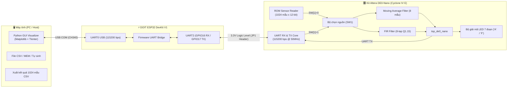

# ĐỒ ÁN MÔN HỌC: THIẾT KẾ VÀ KIỂM CHỨNG BỘ LỌC SỐ DỮ LIỆU CẢM BIẾN TRÊN FPGA
## TOPIC 22: DIGITAL SENSOR FILTER (MOVING AVERAGE & FIR FILTER) ON ALTERA CYCLONE IV E DE0-NANO

---

## 📖 1. Giới thiệu tổng quan (Overview)

Dự án này thực hiện thiết kế, mô phỏng và hiện thực hóa phần cứng bộ lọc số dữ liệu cảm biến đa chế độ trên kit FPGA **Terasic DE0-Nano (Altera Cyclone IV E `EP4CE22F17C6`)**, kết hợp với cầu nối truyền thông vi điều khiển **ESP32 DevKit V1** và giao diện giám sát/điều khiển thời gian thực trên máy tính (**Python GUI**).

Hệ thống cho phép lọc nhiễu các tín hiệu cảm biến dạng số 12-bit có dấu, hỗ trợ cả dữ liệu lưu sẵn trong ROM nội lẫn dữ liệu truyền trực tiếp từ máy tính theo thời gian thực.

### ✨ Các tính năng nổi bật:
- **Hai chế độ lọc số phần cứng chuyên dụng**:
  - **Moving Average (MA)**: Bộ lọc trung bình trượt 8 mẫu, khử nhiễu nhanh, tối ưu tài nguyên logic.
  - **FIR Filter (8-tap Q1.15)**: Bộ lọc đáp ứng xung hữu hạn pha tuyến tính đối xứng, hệ số chuẩn hóa Q1.15, làm tròn đối xứng (symmetric rounding) và bão hòa chống tràn số (saturation) về chuẩn 12-bit signed $[-2048, +2047]$.
- **Nguồn dữ liệu linh hoạt**:
  - **ROM nội 1024 mẫu (M9K Block RAM)**: Tự động phát tuần hoàn ở tốc độ chuẩn $1.000\text{ mẫu/giây}$ (1 kS/s) hoặc cho phép bấm tay kích từng mẫu để quan sát.
  - **UART RX ngoài**: Nhận dữ liệu kiểm thử từ PC (file CSV, tín hiệu nhân tạo) qua vi điều khiển ESP32 với baudrate 115200 bps.
- **Hiển thị trực quan trên phần cứng**:
  - LED 7 đoạn hiển thị ký tự **`A`** khi chạy chế độ Moving Average, và **`F`** khi chạy chế độ FIR.
  - Thanh 8 LED onboard: 7 LED cao hiển thị biên độ dữ liệu, LED[0] chớp giãn xung $200\text{ ms}$ báo hiệu mẫu hợp lệ.
- **Giao diện Python GUI hiện đại**:
  - Vẽ đồ thị thời gian thực sóng vào $x[n]$ và sóng ra $y[n]$.
  - Tự động co giãn trục Y thông minh (**Auto-Fit + 15%** / **Symmetric**).
  - Thu thập và xuất trọn vẹn $1024$ mẫu ROM thành file CSV (kèm dữ liệu mẫu gốc đối chiếu).
  - Trích xuất dữ liệu từ file CSV bất kỳ theo **Hàng (Row)** hoặc theo **Cột (Column)**.

---

## 🏗️ 2. Kiến trúc hệ thống (System Architecture)



---

## 🔌 3. Sơ đồ đấu nối phần cứng (Hardware Wiring)

> [!IMPORTANT]
> Cả kit **DE0-Nano (Cyclone IV E)** và **ESP32** đều hoạt động ở chuẩn điện áp logic **3.3V LVCMOS**. Do đó bạn có thể đấu nối trực tiếp giữa ESP32 và header JP1 của FPGA mà **không cần mạch chuyển mức tín hiệu (logic level shifter)**.

### 📌 Bảng 1: Kết nối giữa ESP32 và Header JP1 DE0-Nano

| Chân ESP32 DevKit V1 | Chân Header JP1 (DE0-Nano) | Tên Pin FPGA | Chức năng | Ghi chú |
| :--- | :--- | :--- | :--- | :--- |
| **GND** | **Pin 12** | `GND` | Nối đất chung | **Bắt buộc nối chung GND** |
| **GPIO16 (RX2)** | **Pin 4** | `PIN_C3` (`UART_TX`) | ESP32 nhận dữ liệu từ FPGA | FPGA gửi chuỗi `+XXXX\n` / `-XXXX\n` |
| **GPIO17 (TX2)** | **Pin 2** | `PIN_D3` (`UART_RX`) | ESP32 truyền dữ liệu sang FPGA | Định dạng khung 2-byte nhị phân |

### 📌 Bảng 2: Kết nối LED 7 đoạn hiển thị ký tự 'A' / 'F' (Header JP1)

Để hiển thị ký tự **`A`** (Moving Average) hoặc **`F`** (FIR), một LED 7 đoạn cathode chung (hoặc anode chung qua cấu hình cực tính) được đấu nối với các chân GPIO trên Header JP1:

| Chân LED 7 đoạn | Chân JP1 (DE0-Nano) | Tên Pin FPGA | Tín hiệu trên Top module |
| :---: | :---: | :---: | :--- |
| **Segment a** | **Pin 3** | `PIN_A3` | `GPIO_00` |
| **Segment b** | **Pin 5** | `PIN_B4` | `GPIO_02` |
| **Segment c** | **Pin 7` | `PIN_B5` | `GPIO_04` |
| **Segment d** | **Pin 8** | `PIN_D6` | `GPIO_05` |
| **Segment e** | **Pin 9** | `PIN_A4` | `GPIO_06` |
| **Segment f** | **Pin 10** | `PIN_B3` | `GPIO_07` |
| **Segment g** | **Pin 13** | `PIN_A5` | `GPIO_08` |
| **Digit 1 (Common)** | **Pin 14** | `PIN_D5` | `GPIO_09` (Điều khiển bật cathode/anode) |

---

## 🎚️ 4. Bảng hướng dẫn Switch & Nút bấm trên Kit DE0-Nano

> [!NOTE]
> **Quy ước công tắc gạt trên bo mạch DE0-Nano:**
> - **GẠT LÊN (UP) = `1` (Bật / ON)**
> - **GẠT XUỐNG (DOWN) = `0` (Tắt / OFF)**

| Thiết bị ngoại vi | Vị trí | Chức năng hoạt động |
| :--- | :---: | :--- |
| **`SW[0]`** | **GẠT XUỐNG (0)** | Chọn bộ lọc **Moving Average (MA)**. LED 7 đoạn hiển thị chữ **`A`**. |
| | **GẠT LÊN (1)** | Chọn bộ lọc **FIR 8-tap Q1.15**. LED 7 đoạn hiển thị chữ **`F`**. |
| **`SW[1]`** | **GẠT XUỐNG (0)** | **Nguồn ROM nội**: Lấy chuỗi 1024 mẫu lưu sẵn trong block RAM. |
| | **GẠT LÊN (1)** | **Nguồn UART ngoài**: Nhận tín hiệu từ máy tính gửi qua ESP32. |
| **`SW[2]`** | **GẠT XUỐNG (0)** | **Chế độ phát tay**: Bấm nút `KEY[1]` từng lần để kích phát 1 mẫu đơn. |
| | **GẠT LÊN (1)** | **Chế độ tự động**: Tự động phát liên tục tuần hoàn với tốc độ $1.000\text{ mẫu/giây}$. |
| **`KEY[0]`** | **Nhấn giữ / Thả** | Phím **Reset hệ thống** (Active-Low). Nhấn giữ = Reset, Thả ra = Chạy bình thường. Đồng thời reset con trỏ ROM về địa chỉ 0. |
| **`KEY[1]`** | **Bấm nhả** | Kích phát **1 mẫu đơn** khi `SW[2] = 0` (Đã tích hợp bộ lọc khử rung phần cứng debounce $5\text{ ms}$). |
| **`LED[7:1]`** | Onboard | Hiển thị 7 bit trọng số cao (`data[11:5]`) của tín hiệu sau lọc. |
| **`LED[0]`** | Onboard | **Chớp giãn xung $200\text{ ms}$** mỗi khi có một mẫu mới được lọc và truyền xong qua UART. |

---

## 📂 5. Cấu trúc thư mục dự án (Repository Structure)

```text
Topic22_Spec_v1/
├── rtl/                                # Mã nguồn phần cứng Verilog
│   ├── top_de0_nano.v                  # Top module tích hợp DE0-Nano, Debounce, LED 7 đoạn
│   ├── moving_average_filter.v         # Bộ lọc Moving Average 8 mẫu
│   ├── fir_filter.v                    # Bộ lọc FIR 8-tap đối xứng Q1.15 (Rounding & Saturation)
│   ├── rom_sensor_reader.v             # Module đọc ROM nội 1024 mẫu (Pacer 1 kS/s)
│   ├── uart_rx.v                       # Module UART nhận khung dữ liệu 12-bit
│   └── uart_tx.v                       # Module UART gửi chuỗi ASCII (+XXXX\n / -XXXX\n)
├── rom/                                # Dữ liệu vector kiểm thử nạp sẵn vào ROM
│   ├── test_vectors_clean.mem          # 1024 mẫu 12-bit signed (Hex format)
│   └── test_vectors.mem                # 1024 mẫu có nhiễu
├── esp32_uart_bridge/                  # Firmware PlatformIO cho ESP32 DevKit V1
│   ├── src/main.cpp                    # Cầu nối UART0 (USB PC) <-> UART2 (FPGA)
│   ├── platformio.ini                  # Cấu hình nạp ESP32 (baud 115200)
│   └── README.md                       # Hướng dẫn chi tiết cho ESP32
├── arduino_uart_bridge/                # Firmware dự phòng cho Arduino Uno R3
│   ├── src/main.cpp                    # Cầu nối HardwareSerial <-> SoftwareSerial
│   └── platformio.ini                  # Cấu hình PlatformIO Arduino
├── python/                             # Phần mềm giao diện giám sát & Xử lý số liệu
│   ├── sensor_filter_gui.py            # Giao diện đồ họa chính (Tkinter + Matplotlib)
│   ├── reference_model.py              # Mô hình toán học kiểm chứng Golden Reference
│   └── generate_data.py                # Script sinh dữ liệu kiểm tra
├── de0_nano.qpf                        # File dự án Quartus Prime
├── de0_nano.qsf                        # File gán chân pin assignments cho DE0-Nano
├── run_gui.bat                         # File launcher 1-click khởi động GUI
├── tidu737.pdf                         # Sổ tay hướng dẫn sử dụng kit DE0-Nano (Terasic)
└── README.md                           # Tài liệu hướng dẫn dự án (File này)
```

---

## 💻 6. Hướng dẫn biên dịch & Vận hành (Step-by-Step Guide)

### Bước 1: Biên dịch và nạp FPGA (Quartus Prime Lite)
1. Mở phần mềm **Quartus Prime Lite Edition** (khuyên dùng bản 18.1, 20.1 hoặc 25.1std).
2. Mở file dự án: `File -> Open Project... -> chọn de0_nano.qpf`.
3. Kiểm tra gán chân trong file [de0_nano.qsf](file:///d:/Quatus22/Final_term/Topic22_Spec_v1_Python_ROM/Topic22_Spec_v1/de0_nano.qsf).
4. Nhấn **Start Compilation** (`Ctrl + L`) và chờ quá trình biên dịch hoàn tất (0 Errors).
5. Kết nối kit DE0-Nano với máy tính qua cáp Mini-USB.
6. Mở **Programmer** (`Tools -> Programmer`), chọn Hardware Setup là **USB-Blaster**.
7. Chọn file `output_files/de0_nano.sof` và nhấn **Start** để nạp vào FPGA.

---

### Bước 2: Nạp Firmware cho ESP32 DevKit V1
1. Cài đặt extension **PlatformIO IDE** trên VS Code.
2. Mở thư mục [esp32_uart_bridge](file:///d:/Quatus22/Final_term/Topic22_Spec_v1_Python_ROM/Topic22_Spec_v1/esp32_uart_bridge).
3. Cắm ESP32 vào cổng USB máy tính.
4. Nhấn biểu tượng **PlatformIO: Upload** trên thanh trạng thái (hoặc gõ lệnh trong terminal):
   ```bash
   cd esp32_uart_bridge
   pio run -t upload
   ```
5. Đấu dây từ ESP32 sang Header JP1 của DE0-Nano theo đúng [Bảng 1](#-3-sơ-đồ-đấu-nối-phần-cứng-hardware-wiring).

---

### Bước 3: Cài đặt và chạy giao diện Python GUI

#### 1. Yêu cầu môi trường Python:
- Cài đặt Python 3.9+ (hoặc Anaconda / Miniconda).
- Cài đặt các thư viện phụ thuộc:
  ```bash
  pip install pyserial matplotlib numpy
  ```

#### 2. Khởi chạy giao diện:
Chỉ cần nhấp đúp chuột vào file:
👉 [run_gui.bat](file:///d:/Quatus22/Final_term/Topic22_Spec_v1_Python_ROM/Topic22_Spec_v1/run_gui.bat)

*(Hoặc mở Command Prompt gõ `python python/sensor_filter_gui.py`)*.

---

## 🖥️ 7. Hướng dẫn sử dụng các tính năng trên Python GUI

Giao diện đồ họa gồm 3 phân khu chính:

### 1. Kết nối Cổng COM:
- Chọn đúng cổng COM của ESP32 (ví dụ: `COM21`), tốc độ `115200` baud.
- Nhấn nút **`Kết nối`** $\rightarrow$ Trạng thái chuyển sang màu xanh: `● Đã kết nối COMxx`.

### 2. Tab 1: Nạp file dữ liệu (Hỗ trợ CSV theo CỘT hoặc theo HÀNG)
- Nhấn **`Duyệt...`** để chọn file `.csv`, `.mem` hoặc `.txt`.
- **Chiều trích xuất linh hoạt**:
  - **Theo CỘT (Column)**: Chọn tên tiêu đề cột (ví dụ: `Sensor_Acc_Z`, `ADC_CH1`,...). Thích hợp cho file bảng dữ liệu cảm biến đa trục.
  - **Theo HÀNG (Row)**: Nhập số thứ tự hàng cần lấy dữ liệu.
- Điều chỉnh tốc độ truyền (mặc định $100\text{ mẫu/giây}$) và nhấn **`Gửi sang FPGA`**.

### 3. Tab 2: Tự sinh tín hiệu kiểm thử (Signal Generator)
- Cho phép sinh tức thời các dạng sóng toán học kèm nhiễu:
  - **Sóng Sin + Nhiễu Gaussian**: Mô phỏng cảm biến rung động/gia tốc bị nhiễu cao tần.
  - **Bước nhảy (Step Response)**: Kiểm tra thời gian đáp ứng và độ vọt lố (overshoot) của bộ lọc.
  - **Sóng vuông (Square Wave)**: Kiểm tra hiện tượng Gibbs.
  - **Nhiễu ngẫu nhiên thuần túy (Gaussian Noise)**.
- Tùy chỉnh trực tiếp: Số mẫu, biên độ, tần số, độ lệch chuẩn nhiễu $\sigma$.

### 4. Tab 3: Giám sát & Ghi trọn vẹn 1024 mẫu ROM nội
- **Thu thập 1 chu kỳ chuẩn**:
  1. Gạt `SW[1] = 0` (ROM), `SW[2] = 1` (Phát tự động 1 kS/s).
  2. Bấm nút **`⏺ Bắt đầu ghi 1024 mẫu ROM`**.
  3. Nhấn nút **`KEY[0]`** trên kit DE0-Nano rồi thả ra (để reset ROM về mẫu số 0).
  4. Sau 1 giây, thanh tiến trình đạt $100\%$ và hộp thoại lưu file `.csv` tự động mở ra.
- **Xuất dữ liệu chuẩn báo cáo**: File CSV kết xuất sẽ tự động gộp 3 cột: `[Index, ROM_Input_x[n], FPGA_Filtered_y[n]]` giúp bạn vẽ biểu đồ nghiệm thu kết quả nhanh chóng.

### 5. Điều khiển hiển thị đồ thị & Tự động co giãn trục Y (Dynamic Auto-Scale):
- **Tự động tối ưu (Auto-Fit + 15%)**: Luôn tự động tính toán $V_{\min}$ và $V_{\max}$ của tín hiệu hiện tại và cộng thêm 15% lề biên, giúp mọi dạng sóng dù biên độ nhỏ hay lớn đều hiển thị to, đẹp và rõ ràng.
- **Đối xứng qua 0 (Symmetric)**: Cân bằng biên độ $\pm M$ quanh trục hoành cho sóng AC.
- **Số điểm hiển thị (Zoom)**: Cho phép điều chỉnh số điểm hiển thị trên màn hình từ 32 đến 2048 điểm để quan sát chi tiết từng xung hoặc tổng thể dài hạn.

---

## 👥 8. Thông tin tác giả & Giấy phép (Credits & License)

- **Đề tài**: Topic 22 – Thiết kế và kiểm chứng bộ lọc số dữ liệu cảm biến (Final Term Project).
- **Nền tảng phần cứng**: Altera Cyclone IV E (Terasic DE0-Nano) & Espressif ESP32 DevKit V1.
- **Ngôn ngữ**: Verilog HDL, C++ (Arduino/PlatformIO), Python 3.
- **Mã nguồn GitHub**: [https://github.com/khoideptraivocung/FPGA-Final-Term.git](https://github.com/khoideptraivocung/FPGA-Final-Term.git)
